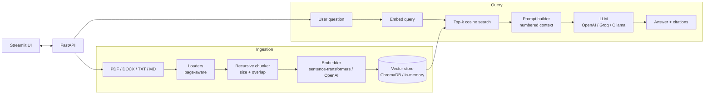

# 📄 RAG Docs Chat — chat with your documents

A production-style **Retrieval-Augmented Generation (RAG)** system: upload PDFs, Word files, text or Markdown, then ask questions and get answers **grounded in your documents with numbered citations** (file + page + the exact chunk used).

Everything is pluggable through environment variables — local or OpenAI embeddings, ChromaDB or in-memory vector store, and OpenAI / Groq / Ollama (or a mock) as the LLM. The full test suite runs offline with no API keys.

## Features
- **Ingestion** of PDF (page-aware), DOCX, TXT and MD
- **Recursive chunking** with overlap (paragraph → line → sentence → word boundaries)
- **Embeddings**: `sentence-transformers` locally (default), OpenAI optional, hashing embedder for offline tests
- **Vector store**: persistent ChromaDB (cosine) or in-memory NumPy store
- **Grounded answers with citations** — the prompt forces the model to cite `[n]` and admit when it doesn't know
- **Pluggable LLM**: OpenAI, Groq (OpenAI-compatible API), Ollama (local), Mock
- **FastAPI** backend (`/ingest`, `/query`, `/documents`, `/health`) + **Streamlit** chat UI
- **Evaluation script** (hit-rate@k, MRR, keyword recall), **pytest** suite, Docker + Compose, structured logging

## Architecture


## Project structure
```
app/
  config.py          # pydantic-settings, all config from env
  main.py            # FastAPI app
  core/
    loaders.py       # PDF/DOCX/TXT/MD -> pages
    chunking.py      # recursive chunker + stable chunk ids
    embeddings.py    # local / OpenAI / hash embedders
    vectorstore.py   # Chroma + in-memory stores
    llm.py           # OpenAI / Groq / Ollama / Mock
    pipeline.py      # ingest + retrieve + generate
ui/streamlit_app.py  # chat UI
scripts/ingest.py    # bulk-ingest a folder
scripts/evaluate.py  # retrieval metrics
eval/qa.jsonl        # small labelled QA set
tests/               # offline pytest suite
```

## Setup
```bash
python -m venv .venv && source .venv/bin/activate
pip install -r requirements.txt
cp .env.example .env        # choose providers / add keys
```

**Run locally**
```bash
uvicorn app.main:app --reload            # API on :8000 (docs at /docs)
streamlit run ui/streamlit_app.py        # UI on :8501
```

**Or with Docker** (includes a local Ollama container)
```bash
docker compose up --build
docker compose exec ollama ollama pull llama3.1
```

## Usage
```bash
# ingest
curl -F "files=@data/sample/company_policy.txt" localhost:8000/ingest
python -m scripts.ingest data/sample

# ask
curl -X POST localhost:8000/query -H "Content-Type: application/json" \
     -d '{"question": "How many days of leave do I get?", "top_k": 4}'
```
Response:
```json
{"answer": "Employees receive 24 days of paid annual leave [1].",
 "citations": [{"ref": 1, "source": "company_policy.txt", "page": null, "score": 0.71, "text": "Leave policy: ..."}]}
```

## Tests & evaluation
```bash
pip install -r requirements-dev.txt
pytest -q                         # offline: hash embedder + in-memory store + mock LLM
python -m scripts.evaluate        # hit_rate@k, MRR, keyword recall on eval/qa.jsonl
EMBEDDING_PROVIDER=local python -m scripts.evaluate   # same, with the real embedding model
```

## Design decisions
- **Interfaces over frameworks.** Embedder, VectorStore and LLM are tiny classes with one or two methods, so swapping providers is a config change and the core logic is easy to read and test. No LangChain dependency, which keeps behaviour transparent.
- **Recursive chunking with overlap** keeps chunks semantically coherent and avoids losing facts that straddle boundaries.
- **Deterministic chunk ids** (hash of source/page/index/text) make re-ingesting the same file an idempotent upsert instead of creating duplicates.
- **Normalised embeddings + cosine similarity**, so the in-memory store is a single matrix-vector product.
- **Citations are first-class**: the prompt numbers each context chunk, and the API returns the source, page, score and text for each, so answers can be verified.
- **Grounding prompt** tells the model to answer only from context and say "I don't know" otherwise, reducing hallucination.
- **Offline-testable**: a hashing embedder and mock LLM let CI run without model downloads or API keys.
- **Groq via the OpenAI-compatible API** avoids an extra SDK.

## Roadmap
- [ ] Hybrid search (BM25 + vectors) and a cross-encoder re-ranker
- [ ] Streaming responses and conversation memory
- [ ] Per-user collections and auth
- [ ] Answer-quality evaluation (faithfulness / relevance, e.g. RAGAS)
- [ ] OCR for scanned PDFs, table extraction
- [ ] Document deletion and re-indexing endpoints
- [ ] GitHub Actions CI

## License
MIT
